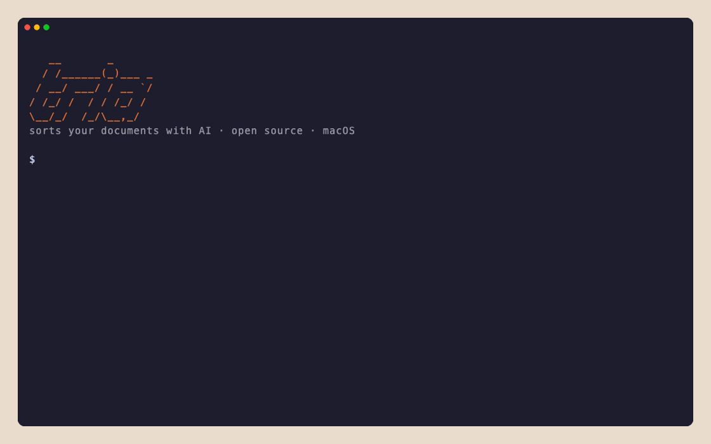

# Lyncat Tria — engine and CLI

**Drop it in the inbox. Tria reads it, names it and files it where it belongs.**



Tria sorts your documents with AI, following rules you write in plain language (`TRIA.md`). You drop documents in an
inbox; Tria reads each one, proposes a clear name and a folder, and you decide. It never deletes or overwrites
anything, and everything can be undone.

This repository holds the engine (`TriaKit`) and the `tria` command-line tool for macOS. The CLI works with your own
Anthropic or OpenAI API key. The [Mac app](https://tria.lyn.cat) uses the same engine.

## What it looks like

Six documents with useless names in the inbox of a made-up Spanish company (`tria sort --dry-run`, with
`TRIA_LANG=en`; the reasons come in the language of the documents):

```text
$ tria sort --dry-run
Tria · Empresa · Anthropic claude-sonnet-5-5
Looking for documents in 99-Pendiente…
✓ 6 documents read in 6 s
 2/6  descarga (2).pdf
      → 7-Facturas/Emitidas/2025/3T/Factura Emitida 2025-031 Distribuciones Norte - 2025-08-12.pdf
      ● Confidence high · Factura emitida por EMPRESA EJEMPLO SL a Distribuciones Norte con fecha 12/08/2025, por tanto 3T de 2025.
 4/6  Escaneo 14-10-2026.pdf
      → 8-Nominas/Nominas - 2025-09.pdf
      ● Confidence high · Resumen de nóminas de septiembre 2025 de la propia sociedad, va a la carpeta de nóminas con el formato Nominas - AAAA-MM.
 6/6  Scan_20261011_0012.pdf
      → 7-Facturas/Recibidas/2025/1T/Factura Imprenta Litoral - 2025-02-21.pdf
      ● Confidence high · Factura emitida por Imprenta Litoral SL a la sociedad, por tanto recibida, con fecha de febrero de 2025 (1T).
…
6 ready
Tokens: 1363 input · 932 output · 9544 cached · approximate cost: 0.0617 USD
```

Without `--dry-run`, `tria sort` opens a full-screen review where you approve, change or skip each proposal before
anything moves. To measure it on your own archive, see `tria eval` below; `tria eval --synthetic` runs it on a
bundled made-up archive.

## Principles

1. **It always reads the content.** It never sorts by file name.
2. **It never deletes or overwrites.** The Trash, only if you ask for it.
3. **When in doubt, it asks.** Doubtful documents stay in the inbox, with their question.
4. **Everything is logged and can be undone** (`tria undo`).
5. **With your own key, your documents never go through Start.cat.** Text is extracted on your Mac and sent straight
   to your AI provider.

## Install

```bash
brew install startcat/tap/tria
```

Requires macOS 14 or later.

## Getting started

```bash
tria config --provider anthropic --set-key   # stored in the macOS Keychain; or --provider openai
cd ~/Documents/Business
tria init --template sl --lang es            # creates TRIA.md and PERFIL.md · or: autonomo, hogar · or --learn
# drop documents in 99-Pendiente/
tria sort                                    # proposes; you review and apply
tria undo --last                             # if something isn't right
```

The templates are for Spain: `autonomo` (freelancer), `sl` (company) and `hogar` (home), in Spanish (`--lang es`) or
Catalan (`--lang ca`). With `--learn`, Tria learns the rules from how your folder is already organized.

## Commands

| Command | What it does |
|---|---|
| `tria init` | Creates a workspace: `TRIA.md`, `PERFIL.md`, the inbox and the duplicates folder |
| `tria sort [--auto] [--dry-run] [--json] [--show-prompt] [--no-cache]` | Processes the inbox. In a terminal, with a full-screen review; `--auto` applies only high-confidence proposals and exact duplicates |
| `tria status` | Shows the inbox and the status of each document, without calling the AI |
| `tria undo [--last \| <batch>]` | Undoes the last batch or a specific one |
| `tria log [<batch>]` | History of batches and moves |
| `tria rules check \| learn \| suggestions \| ask "…"` | Validates `TRIA.md`, drafts rules from the folder, manages the rules suggested by your corrections, or asks Tria for a change in one sentence (shown before it's applied) |
| `tria config` | Provider, model and API key |
| `tria eval <folder>` | Measures accuracy against an already sorted archive, working on copies |

`tria help <command>` explains each one. `tria sort` exits with 0 when nothing is left pending, 1 when something is,
2 on error and 130 when interrupted with Ctrl-C. Ctrl-C never moves anything that hasn't been applied.

Each workspace keeps a log (`.tria/journal.jsonl`) of where every document went, with the confidence, the reason and
the model that read it.

## `TRIA.md`

The header sets what always applies; the body, in plain language, explains your folders and your naming.

```markdown
---
inbox: 99-Pendiente
duplicates: 98-Duplicados
protected:
  - "7-Facturas/20*/"          # Tria never moves anything into or out of these
new_folders: subfolders_only   # never | subfolders_only | anywhere
---
# Organización de documentos
## Carpetas
## Nomenclatura
## Casos especiales
```

`PERFIL.md` says who owns the archive (name, tax ID, partners, clients, banks…), so Tria can tell what you issue from
what you receive. `tria rules check` validates both.

## Privacy

- What goes to your provider: your rules, your profile (`PERFIL.md`), the folder tree with a few example names, the
  document's original name and dates, and an excerpt (the first 3 pages, at most 12,000 characters). Page images are
  sent only when there is no readable text.
- `tria rules ask` sends your request, `TRIA.md`, the folder tree and `PERFIL.md`; no documents.
- `tria sort --dry-run --show-prompt` prints exactly what is sent, before sending it, and moves nothing.
- No telemetry. Keys live only in the Keychain or in `ANTHROPIC_API_KEY` / `OPENAI_API_KEY`. OpenAI is called with
  `store: false`.
- The CLI never uses Tria AI, the Mac app's optional paid AI. Its client contract is in `Sources/TriaCore/TriaAPI/`,
  so you can see what the app sends when you choose it; the [privacy policy](https://tria.lyn.cat/en/privacy)
  explains what is stored and for how long.

## Languages

The CLI speaks Catalan, Spanish and English, following your system language. To choose one, set `TRIA_LANG=ca`,
`es` or `en`.

## Building from source

Requires Xcode 16 or later (Swift 6).

```bash
swift build -c release   # the binary is in .build/release/tria
swift test
```

`scripts/build-release.sh` builds the universal binary (arm64 and x86_64) in `dist/tria`.

## Documentation

The full documentation is at [tria.lyn.cat/en/docs](https://tria.lyn.cat/en/docs), also in
[Catalan](https://tria.lyn.cat/ca/docs) and [Spanish](https://tria.lyn.cat/es/docs).

## License

Apache-2.0.

---

**A [Start.cat](https://start.cat) product** · Lyncat Tria
